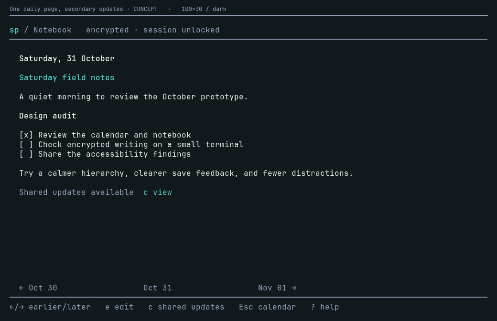
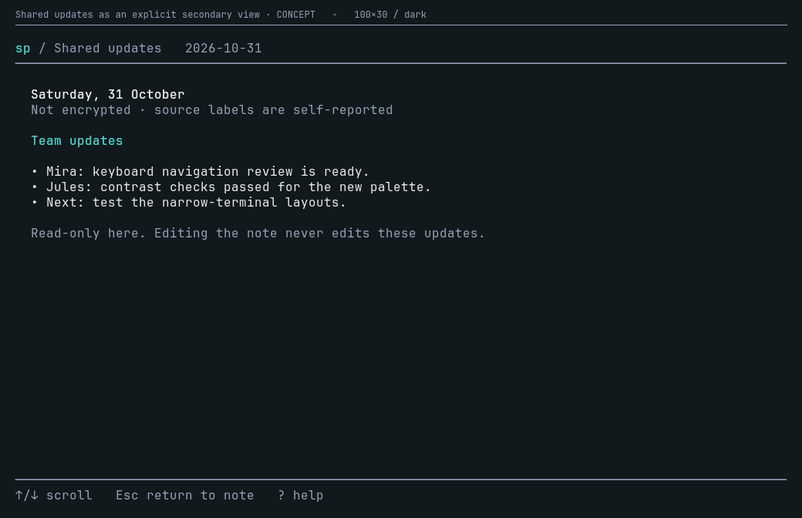
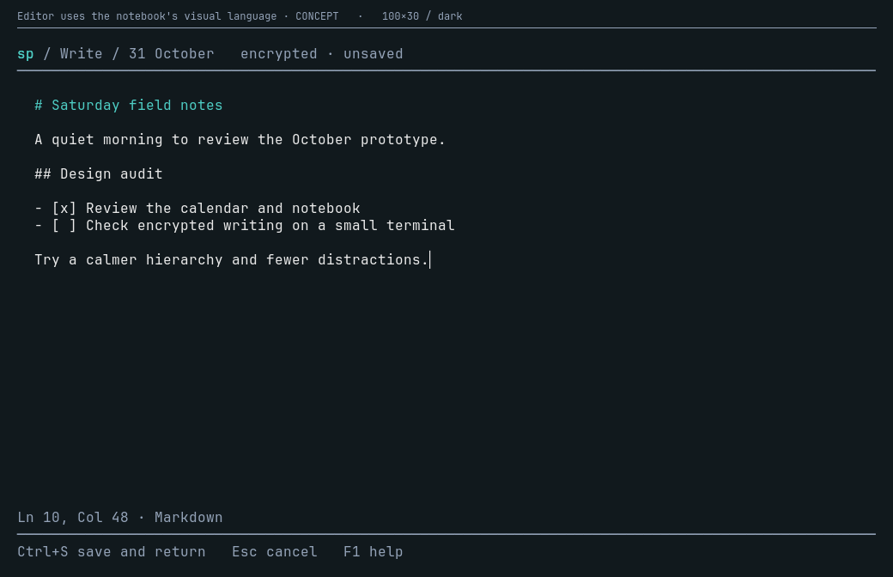
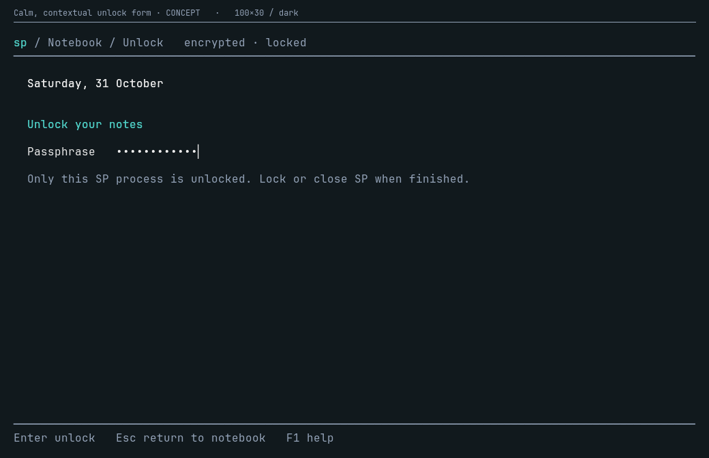
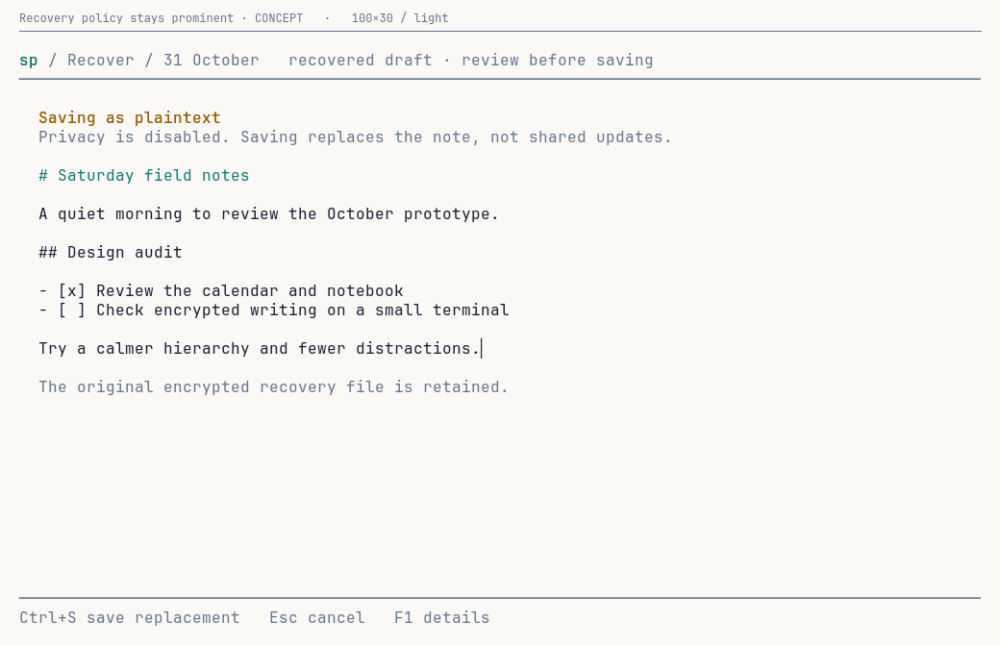
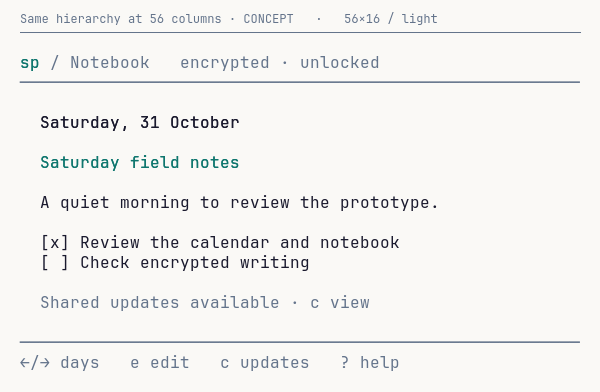

# SP visual design pass

**Status: audit and proposed direction, not an implemented redesign.**

The goal is a quiet daily notebook, not a vault administration interface with a
notebook bolted on. Encryption should change access and save guarantees, not the
product's visual language.

## What was captured

- **170 production-model frame captures**: 39 TUI scenes in dark/light at 100×30,
  plus encrypted-state variants at 80×24 and 56×16.
- **28 hand-composed concepts**: 14 proposed states in dark/light, including a
  compact notebook. These are explicitly labelled CONCEPT, not application output.
- All writing, updates, errors, paths and secrets are synthetic. No real store,
  editor configuration, crypto job, clipboard or external editor is involved.
- Images render production ANSI into a fixed-cell grid. They are **not desktop
  screenshots or live-PTY recordings**. Cursor animation, native terminal fonts,
  keyboard interaction and screen-reader usability are not validated by them.
- The baseline is the UI after `5c5620d`. No production behavior, keys, storage,
  privacy guarantee or editor integration was changed for this study.

The individual captures and filterable local galleries are generated under:

- `.privacy-adversarial/design-review/current/index.html` — production views
- `.privacy-adversarial/design-review/concepts/index.html` — proposed direction

This review's original baseline is also retained locally under
`.privacy-adversarial/design-review/before/`. The curated images below are checked
in; the large generated galleries are ignored and reproducible.

```sh
make design-capture                         # Go, Python 3, ImageMagick
# Optional: an explicit installed/downloaded monospace font for consistent output.
SP_DESIGN_CAPTURE_FONT=/path/to/Mono.ttf make design-capture
python3 -B -m unittest discover -s scripts/design-capture
```

The checked-in images use JetBrains Mono, obtained from the
[font's public repository](https://github.com/JetBrains/JetBrainsMono). The font
file is not bundled, installed or downloaded by the capture target. Font choice
changes rasterization, not the captured View() output.

## The two product decisions

### 1. One daily page, shared updates secondary

**Recommendation:** make the note the primary document. Remove the competing
“Private notes” heading from ordinary reading. Show a quiet storage/session badge
in the common header instead of explaining the storage schema inside the note.

When contributions exist, show **Shared updates available** with one explicit
viewer action. Open them as a secondary, read-only view; return restores the
note's reading position. Do not show an empty heading or an empty updates view.
Do not call updates “new” unless the app actually tracks read state.

The secondary view clearly says **Not encrypted** and explains self-reported
source labels there, where that distinction matters. Shared updates remain
reachable while the note is locked. The concept's `c` action is a proposal and
is **not currently wired**.

This is a presentation change, **not** a proposal to combine stored documents,
append private writing into shared text, or pass a combined document to an editor.
Keep the independent Markdown renderers and private-only edit buffer. A simpler
alternative is a collapsed inline updates area; the dedicated secondary view is
recommended because it keeps the normal notebook quieter and its footer stable.

| Current production frame | Proposed direction — not implemented |
| --- | --- |
|  |  |



### 2. Earlier left, later right

**Recommendation:** Left/h goes to an earlier saved day; Right/l goes to a later
saved day. Display the date strip in that same chronological direction.

The calendar already maps Right to moving forward. The notebook currently does
the opposite: dates descend left-to-right and Right means older. Keeping two
opposite spatial models is harder to learn than either one alone. Newest-first
is sensible for a vertical feed, but less natural for horizontal page turning.

Preserve today-first startup, existing saved-day navigation, first/last bounds,
direct date selection and per-date reading positions. This is a deliberate
navigation contract change, not a cosmetic label edit. The concepts show the
recommended mapping; **the application still uses its existing mapping**.

## Why the encrypted screens feel unrelated

The issue is not that SP avoids Charm. It already uses Bubble Tea, Lip Gloss,
Glamour, Bubbles viewport and Bubbles textinput.

The concrete inconsistencies are:

- `internal/tui/privacy.go`: editor help and conflict review receive `Palette{}`;
  editor title, caption, position and controls mostly render as unstyled strings.
- `internal/tui/notebook_render.go`: equally prominent personal/shared headings
  repeat the header's lock state and compete with the note's own heading.
- `internal/tui/privacy.go` and `date_jump.go`: forms have different spacing and
  nearly empty full-screen layouts, with instructions scattered near the top.
- `internal/tui/notebook.go`: the date strip, rule and wrapping control list
  consume several rows and repeat quit/back choices.
- Standard Glamour heading colors introduce a purple block and bright blue that
  do not share the application's calmer teal hierarchy.
- Save/recovery errors can become a long, visually weak status line. Distinct
  outcomes need distinct visible summaries, not just more explanatory words.

### A common shell, not more decorative boxes

Use the same structure in every mode:

1. **Header:** small `sp / location`, selected day, compact session/storage state.
2. **Body:** a consistent two-cell inset; writing is the visual priority.
3. **Outcome/position:** stable, subordinate metadata; errors stay prominent.
4. **Footer:** three to five useful actions; expanded bindings remain in help.

Keep the existing teal identity, warm selected-date accent and plain terminal
background. Avoid rainbow controls, ASCII-art locks, nested borders and large
privacy banners. Color reinforces explicit words; it never carries state alone.
“Encrypted” describes storage/save policy, not an absence of plaintext memory.

### Writing and unlocking

| Current production frame | Proposed direction — not implemented |
| --- | --- |
|  |  |
|  |  |

Do not headline implementation details such as “Built-in editor.” Keep the
relevant guarantee available in help, and keep the actual save policy visible.
The writer sketch is a chrome/layout study, **not a decision to replace Neovim or
expand the custom editor into an IDE**. The unresolved editor-integration/privacy
contract remains separate.

Use Bubbles textinput/spinner/help/key where they fit; use Lip Gloss consistently
for the shared shell. Keep the lossless private input adapter unless a replacement
passes exact-byte, CRLF/tab/grapheme, history, input-isolation and no-file tests.
A component substitution is not automatically a usability or privacy improvement.

## View-by-view direction

| View family | Main change |
| --- | --- |
| Month | Keep the spatial calendar; reduce repeated focus/date text. Selection dominates, previews are secondary. Private history remains undecrypted. |
| Year | Keep the grid/activity overview. Quiet empty months, retain an understandable full-month timeline legend. |
| Notebook | One daily page; no repeated private-section title. Chronological date strip and one secondary updates affordance. |
| Empty notebook | “Start today's note” plus a clear action, in the same shell—not a top-left diagnostic dump. |
| Locked notebook | A calm locked state in the notebook, not a separate product. Preserve access to available shared updates. |
| Shared updates | Explicit read-only secondary context. Not encrypted; source labels self-reported; never editable as private text. |
| Unlock/retry | Contextual form, visible focus, one sentence about session scope. An incorrect secret clears safely; errors sit beside the field. |
| Unlock/busy/cancel | Same form shell. Spinner for unknown-duration work, not invented percentages. Cancellation still waits before locking. |
| Private writer/find | Common header/footer/palette; quiet line/column metadata. Preserve literal text and find's isolated input ownership. |
| Save/recovery failure | Short persistent outcome and next action, with complete error/path in F1 and retained exit reporting. “Recovery failed—keep editor open” must not be understated. |
| Conflict review | A purpose-built saved/draft comparison with a visible selected action. Keep quoted controls, explicit Enter authorization and a further real save. |
| Recovery | Persistent encrypted/plaintext save policy; explicit replacement scope. Never hide plaintext saving behind generic “private” branding. |
| Templates | One clear selection list, quieter history badges. Keep **saves now before editing**, append-again semantics and cancellation-after-publication truthfulness visible. |
| Date jump | Reuse the form shell. Short exact-format label and error; selection only, never saving. |
| Help | Shared themed shell, grouped by Move / Write / Session. Full errors remain scrollable. F1 remains the typing-context help key. |
| Small terminals | Preserve the hierarchy, reduce optional chrome first, then use the existing truthful resize fallback. No hidden controls or clipped recovery policy. |





## Implementation order

- [x] Inventory and inspect all primary TUI families and key encrypted states.
- [x] Produce reproducible baseline captures and labelled visual concepts.
- [ ] **Shared visual primitives:** palette propagation, consistent chrome,
  branded Markdown and form/error hierarchy. No key/storage changes in this unit.
- [ ] **Chronological navigation:** change keys, footer order and help together;
  retain startup, bounds and date-keyed positions. Validate real keyboard use.
- [ ] **Secondary shared updates:** an explicit read-only viewer state with
  no automatic unlock, private-cache projection or publication side effects.
- [ ] **Review/help/template refinement:** improve grouping and short outcomes
  while preserving existing confirmation, cancellation and durability semantics.
- [ ] Re-capture the same fixtures after each implementation batch, compare at
  common/narrow sizes, then validate live PTYs and both native themes.

Test the design with concrete tasks: go from October 31 to the prior entry;
open an agent's update without unlocking; unlock and return to the intended
operation; identify whether a failed save published; identify a plaintext
recovery save; cancel without losing the only copy of a draft.

These are usability tasks, not completed accessibility/user-research sign-off.
CLI enable/disable/status are text command flows, not covered by the TUI image
atlas; their warnings and confirmations require a separate live-terminal pass.

## Validation of the capture tools

Full `go test ./...` and `go vet ./...` pass. The opt-in exporter also passes under
`-race`, checks dimensions and deterministic output, and rejects leaked synthetic
passphrase text. Six Python unit tests cover ANSI color/reset/links/cell positions,
concept bounds and explicit production/concept labelling. `make design-capture`
successfully regenerates both galleries. These are tooling checks, not validation
of the proposed runtime interactions.

## Design references

- [Nielsen's usability heuristics](https://www.nngroup.com/articles/ten-usability-heuristics/):
  natural mapping, consistency, visible status, user control and minimalist design.
- [Bubbles v0.18 components](https://github.com/charmbracelet/bubbles/tree/v0.18.0):
  reference the version this project actually uses, not a speculative upgrade.

The structural proposals need a product decision; checked UX fixes in `TODO.md`
remain implemented. This study does not erase those fixes or mark the redesign
as shipped.
