# SP visual redesign

**Status: implemented and locally validated.** The original concepts are retained
as historical design studies; the screenshots in this section are actual current
production `View()` output from the captured synthetic fixtures. This dated study
is not a regenerated atlas of every later commit; current release evidence is
recorded in [release preflight](../../release-preflight.md).

The product remains a quiet daily notebook. Encryption changes access and save
guarantees, not the product's visual language. The redesign does not settle the
separate Neovim/private-editor integration decision.

## Notice and alignment follow-up

Startup feedback previously replaced the divider, making chrome run into the
note; its left edge also differed from the document's. The shared header now
reserves separate title and notice rows and **always** draws the divider below
them. Header, notice, document and action text share the two-cell gutter. Geometry
budgets use the common header height, including small unlock forms and help.

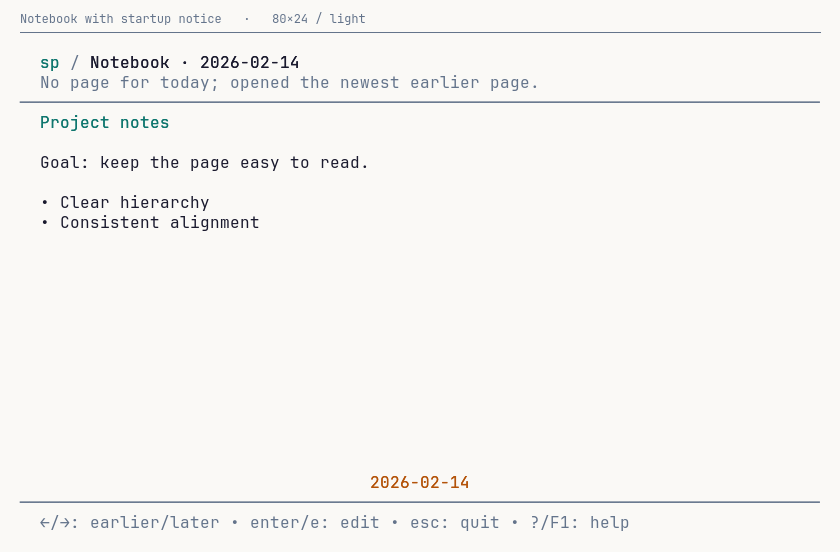

This is the latest geometry example. The broader atlas/illustrations below record
the initial redesign snapshot; `make design-capture` regenerates them from current
source. Unit tests, TUI race tests, vet, all 402 frame-bound checks and four live
synthetic dark/light/narrow design-terminal cases pass. The latter tested binary
SHA256 `aaf6cbf684c8df6ff6b5d12687bdd2390b7271f6889804bd7a3218372124af09`,
fixture `.privacy-adversarial/design-terminal-0e1b0398fb282034`. That capture
candidate had Windows cross-compilation only. Later native unit CI was reported
green separately; neither result establishes native Windows interactive or
GUI/accessibility validation. No user note text was copied into these fixtures
or screenshots.

## Current implementation

- One primary daily note. Shared updates are a separate **read-only** view,
  opened with `c` only when updates exist. No competing private/agent headings.
- **Left/h = earlier saved day; Right/l = later saved day.** The date strip reads
  in that same chronological direction. Today-first startup and date-keyed
  reading positions are retained.
- Consistent `sp / location` chrome, teal Markdown headings, two-cell document
  inset, quieter metadata and compact default actions. Expanded help is grouped.
- The same appearance reaches unlock, writing, recovery, comparison, templates,
  date forms and help. Bare private editing/recovery uses the configured theme.
- Save policy stays visible. Short outcomes retain complete F1 details and exit
  recovery reporting. Failed recovery tells the user to keep the editor open.

### Daily note and shared updates

| Before | Implemented |
| --- | --- |
| 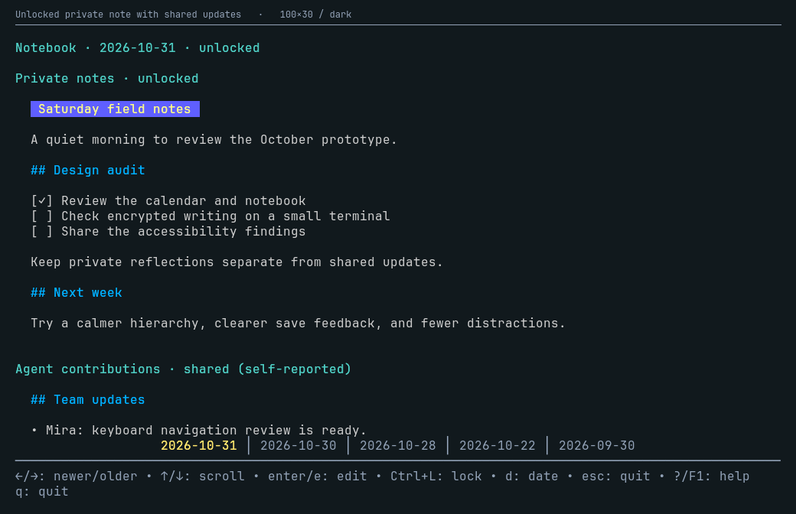 | 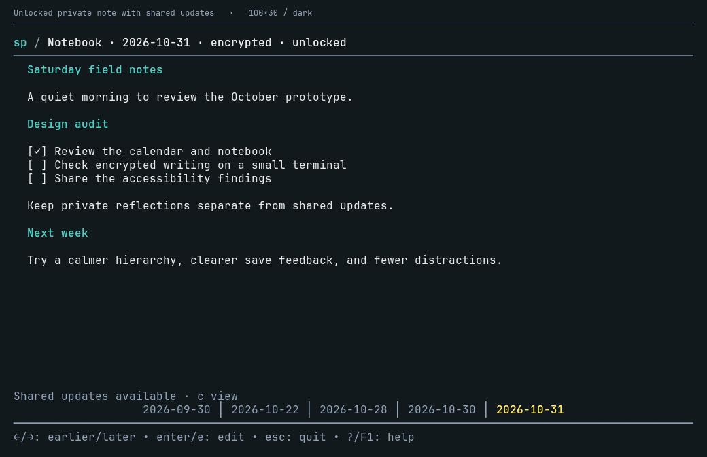 |

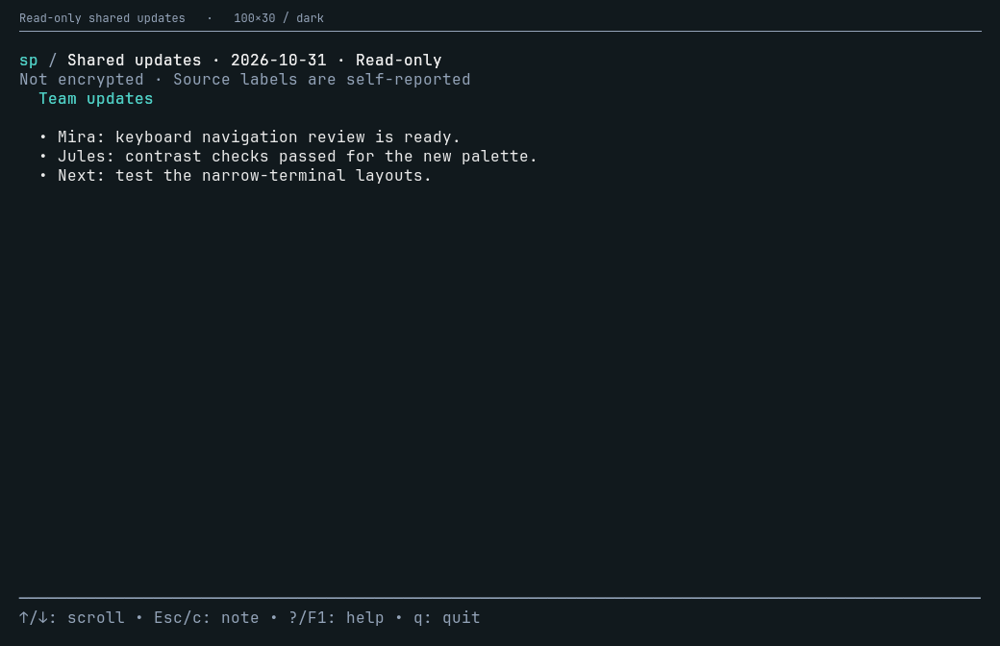

The secondary view explicitly says **Not encrypted** and that source labels are
self-reported. It is available while locked without unlocking, loading private
writing, or invoking editing/template/date/publication actions. Esc/c returns to
the note's position; help closes before the pane beneath it. Opening updates does
not mark them “read” or create metadata writes.

Storage and edit ownership are unchanged: private and shared Markdown are not
concatenated, merged into one editor buffer, or projected into each other's
caches. Locking also clears a hidden private viewport while shared updates remain
on screen. Saved-empty, absent and shared-only personal-note states stay distinct.

### Writing and unlocking

| Before | Implemented |
| --- | --- |
| 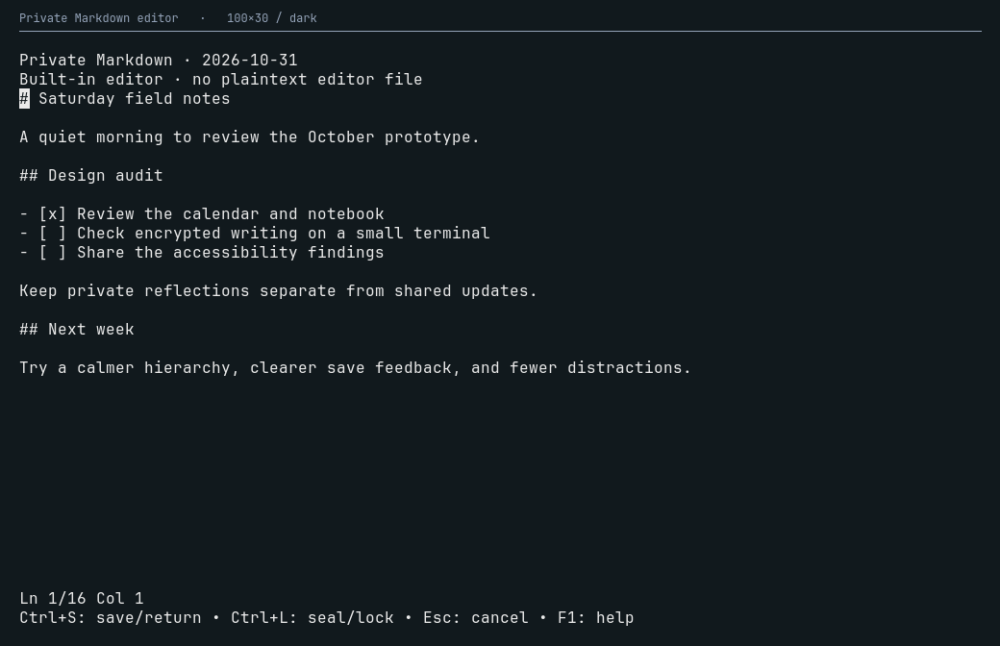 | 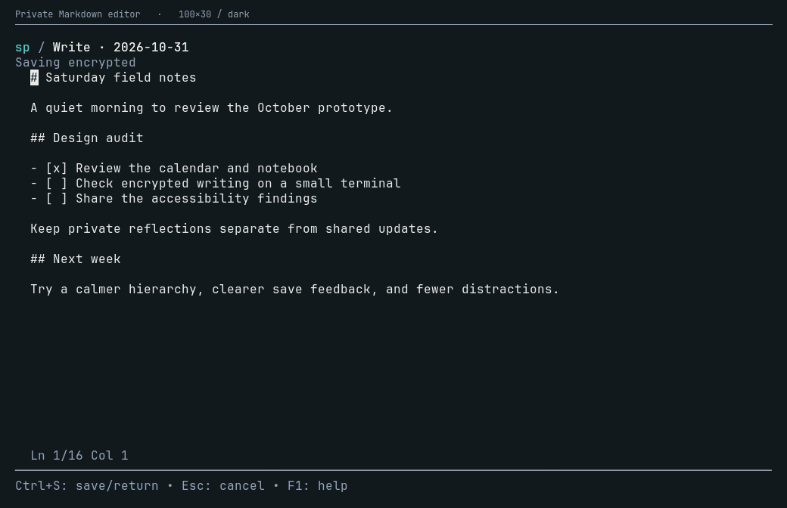 |
| 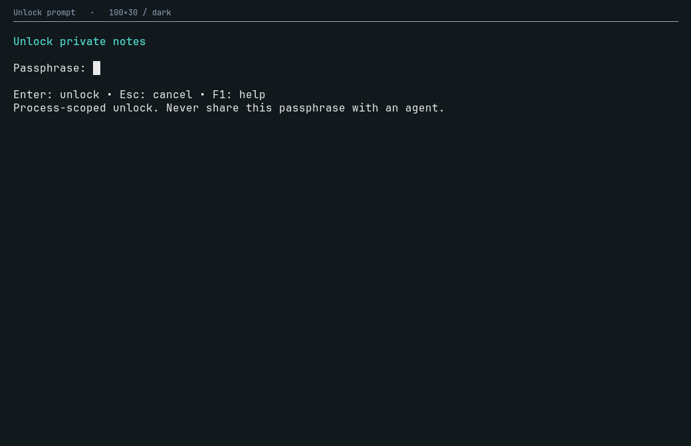 | 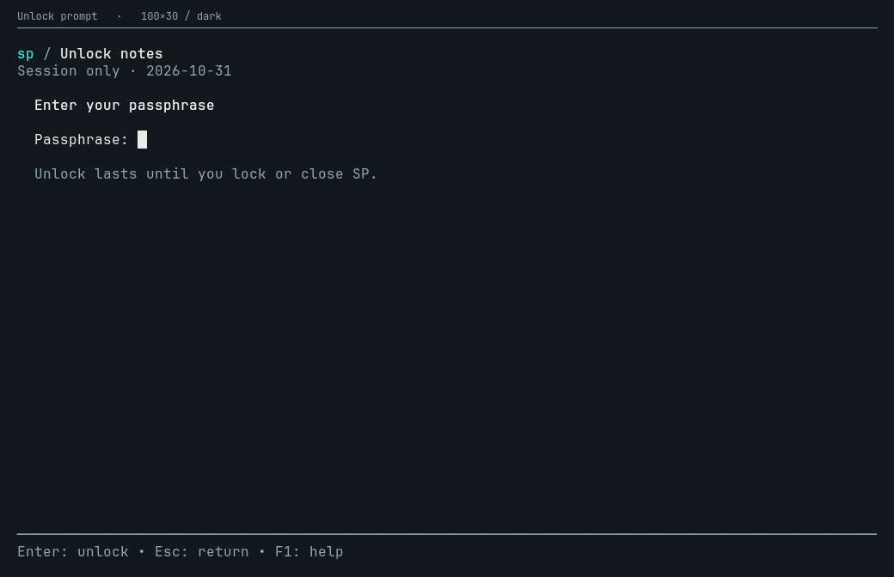 |

The writer no longer headlines implementation details such as “Built-in editor.”
Its lossless custom input, exact Markdown bytes, memory-only history, find/input
isolation and encrypted recovery safeguards are unchanged. F1 exposes full
technical details. Appearance changes never rewrite configuration or note bytes.

The unlock form measures its field, current error and actions together. An
unsupported size shows a resize hint and cannot submit an invisible field;
masked input is retained until a supported resize or explicit cancellation.
Busy/cancelling states keep their scope and wait for owned cryptographic work.

### Calendar, forms, recovery and review

| Month | Year |
| --- | --- |
| 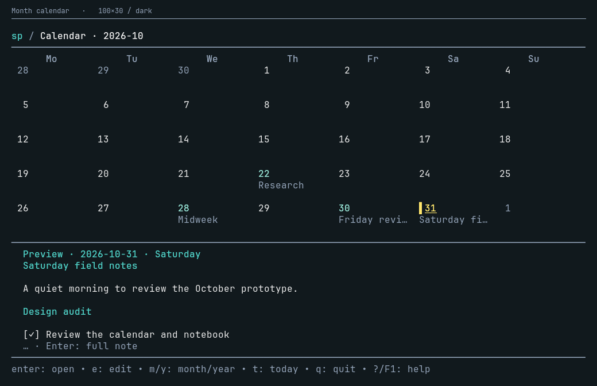 | 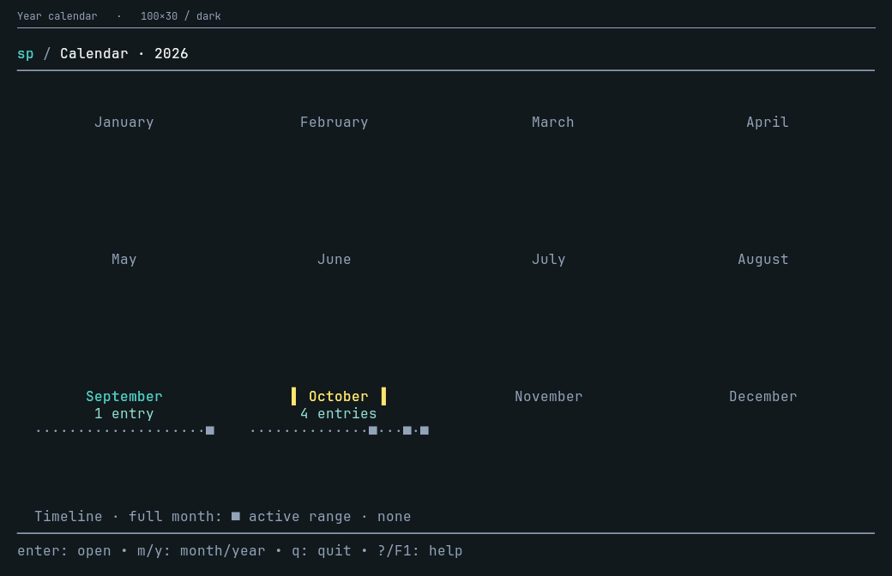 |

The calendar prioritizes useful prose before growing mostly empty day cells.
Narrow layouts retain a smaller excerpt when possible; complete grids and
full-month activity summaries remain intact. Private history is never decrypted
for calendar previews, even when the session is unlocked.

| Templates | Date form |
| --- | --- |
| 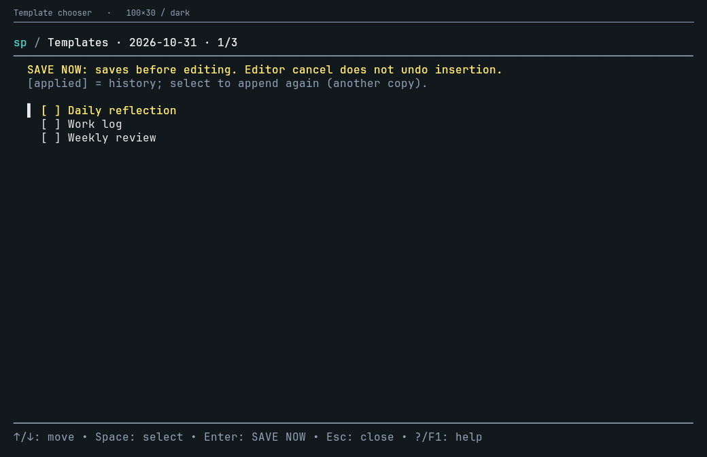 | 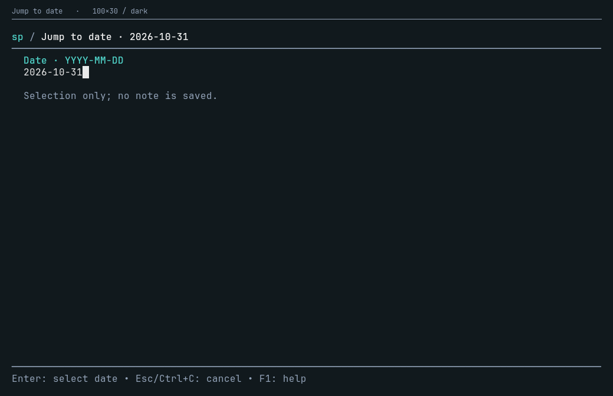 |

Templates still make **SAVE NOW before editing** explicit. Editor cancellation
does not undo insertion. Selection, applied history and append-again remain
separate; cancellation waits for the actual publication outcome, not an invented
rollback. Date navigation remains exact-format selection, never a save.

| Saved/draft comparison | Compact plaintext recovery |
| --- | --- |
| 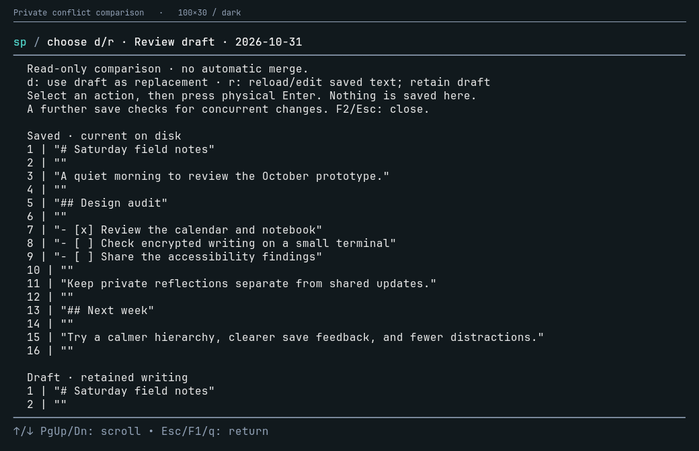 | 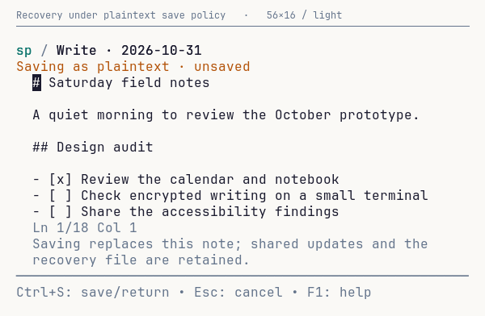 |

Comparison quotes source lines rather than interpreting note-originated controls.
The selected action remains visible while scrolling; physical Enter authorizes
it, and replacement still requires a real save. Recovery persistently distinguishes
**Saving encrypted** from **Saving as plaintext**, preserves shared updates and
the source artifact, and checks the reviewed policy at publication.

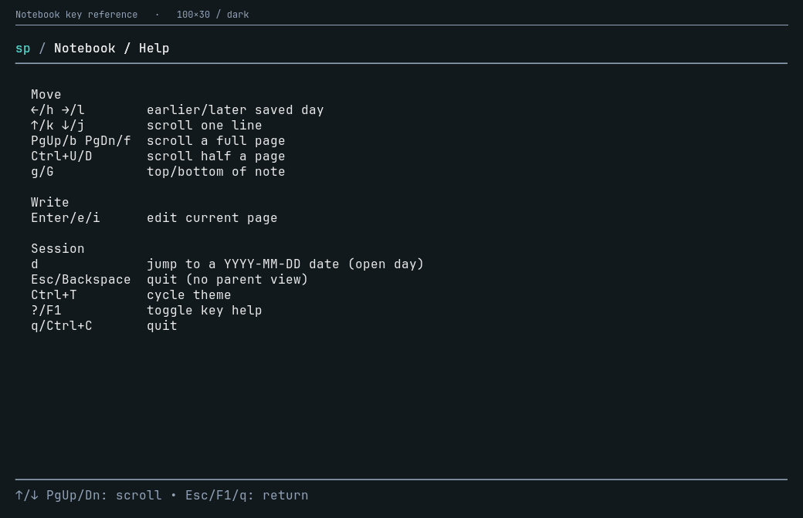

## Full view atlas

The original audit exported **170 frames across 39 scenes**. The implemented
atlas now exports **402 frames across 53 scenes**, in dark/light at 100×30,
80×24 and 56×16, with additional 40×12 variants for encrypted/error states.
All 402 current frames have individual PNGs and a filterable local gallery.

- `.privacy-adversarial/design-review/current/index.html` — **current application**
- `.privacy-adversarial/design-review/concepts/index.html` — historical static concepts
- `.privacy-adversarial/design-review/before/index.html` — original local baseline

The current atlas includes primary/secondary/empty/locked/unlocked/unavailable
notes, ordinary and encrypted calendars, unlock input/retry/busy/cancellation,
writer/find/help/conflict/save/recovery/durability failures, both recovery save
policies, template selection/history/retry/pending work, date validation and help.

Images render actual production ANSI in a fixed-cell grid; they are **not native
desktop screenshots or live-PTY recordings**. All writing, errors, paths and
secrets are synthetic. The exporter uses no real store, editor configuration,
watchers, clipboard, crypto job or external editor. Static concepts are labelled
CONCEPT, not application output. The checked-in images use JetBrains Mono from
its [public font repository](https://github.com/JetBrains/JetBrainsMono); the font
file is not bundled or downloaded by the target.

```sh
make design-capture                 # Go, Python 3, ImageMagick
SP_DESIGN_CAPTURE_FONT=/path/to/Mono.ttf make design-capture
python3 -B -m unittest discover -s scripts/design-capture
make design-terminal                # real synthetic POSIX PTY flows
```

The atlas is deliberately larger than the original concept subset. PNG generation
is bounded to four ImageMagick processes by default and may take several minutes.
The frame export is independent of the PNG renderer. Original hand-composed
concept images remain in `assets/proposed-*.png` for historical comparison.

## Completed implementation plan

- [x] Inventory and inspect primary TUI families and encrypted states.
- [x] Produce reproducible baseline captures and labelled concepts.
- [x] Shared visual primitives, palette propagation, branded Markdown and forms.
- [x] Chronological keys, pager and help; retain startup, bounds and positions.
- [x] Read-only secondary updates with no implicit private action/publication.
- [x] Review/help/template refinement with existing authorization and durability.
- [x] Re-capture all scenes and validate actual dark/light, ordinary/narrow PTYs.

Key implementation paths: `layout.go`, `markdown.go`, `private_view.go`,
`shared_updates.go`, `notebook*.go`, `calendar.go`, `date_jump.go`,
`template_chooser.go`, `draft_review.go`, and `key_help.go` in `internal/tui/`.

## Validation and limits

- Full `go test ./...`, `go test -race ./...`, `go vet ./...` and build pass.
  The opt-in exporter also passes under race; all frames stay within bounds and
  never expose the synthetic passphrase. Six Python capture-tool tests pass.
- **11 privacy-terminal checks**, **7 UX-terminal workflow groups**, and **4
  design-terminal cases** pass. The latter exercises actual dark/light terminals
  at 100×30 and 56×16: chronological arrows/vi keys, locked shared access, action
  isolation, reading continuity, relocking, theme/help and unchanged store bytes.
- Those PTY suites tested candidate SHA256
  `66f48da4436924971a1464e4450276e398f798aede46a13eb8a4c95f13ddecbb`.
  Fixtures: `terminal-8310617f7b547ee5`, `ux-terminal-b3de89c7f3019043`, and
  `design-terminal-b39d8d38b2860f0e` under `.privacy-adversarial/`. No transcript
  was saved; no real notes/editor configuration were accessed.
- Review found and tests cover two additional edge cases: a newer draft after an
  unconfirmed publication must be explicitly unsaved; a cramped unlock form must
  not accept a hidden field. Calendar captures also prompted a more useful prose
  budget. Static review is not an independent security audit.
- Windows amd64 cross-compilation passes, **not native execution**. Native GUI,
  Windows runtime, accessibility/user research, independent crypto/dependency
  review and release/publication verification remain separate outstanding gates.
  Existing lint remains blocked by the installed v1/v2 configuration mismatch.

The 40 earlier UX fixes remain implemented. Storage/privacy guarantees were not
weakened; no plaintext-editor fallback or mandatory-Neovim decision was introduced.

## Design references

- [Nielsen's usability heuristics](https://www.nngroup.com/articles/ten-usability-heuristics/):
  natural mapping, consistency, visible status, user control and minimalist design.
- [Bubbles v0.18 components](https://github.com/charmbracelet/bubbles/tree/v0.18.0):
  reference the project's actual version, not a speculative component upgrade.
